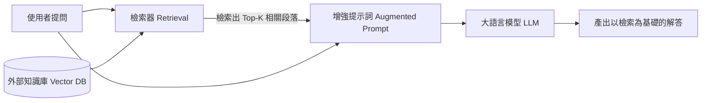

# 01. 什麼是 RAG 與為什麼需要它？

## 一、導論：大語言模型（LLM）的現實困境
在生成式人工智慧（Generative AI）快速發展的今天，大語言模型（Large Language Model, LLM，如 GPT-4、Claude、Llama）展現出驚人的語言理解與組織能力。然而，當我們將一般基底模型直接投入工程或企業應用時，常會遇到三個核心瓶頸 [^4]：

1. **模型幻覺（Hallucination）**：
   - 模型本質上是「文字機率預測器（Token Predictor）」，它優先追求句子的通順合理，而非事實的正確性。
   - 當被問及未知領域或冷門事實時，模型往往會以極具說服力的語氣「一本正經地胡說八道」。
2. **知識截斷（Knowledge Cutoff）**：
   - 模型的知識被「凍結」在完成訓練的那一天。對於昨天發生的新聞、剛發布的新法規、即時股票數據或當前的伺服器狀態，模型一無所知。
3. **缺乏私有領域知識與來源溯源（Lack of Private Data & Attribution）**：
   - 企業內部機密、個人實驗室筆記或專有硬體規格書，絕不可能存在於公開網路預訓練資料中。
   - 此外，純模型回答時無法主動提供原始出處與頁碼，難以進行事實查核（Fact-checking）。

---

## 二、什麼是檢索增強生成（RAG）？
**檢索增強生成（Retrieval-Augmented Generation, RAG）** 是一種結合「資訊檢索系統（Information Retrieval）」與「文本生成模型（Generative Model）」的混合架構，最早由 Meta AI（Patrick Lewis 等人）於 2020 年的經典論文中正式提出 [^1]。

### 經典生活比喻：閉卷死背 vs. 開卷查資料
* **純 LLM（未加 RAG）**：如同要求學生參加一場**「閉卷考試」**。學生只能依賴大腦中硬背下來的記憶作答；一旦記憶模糊或沒背過，就只能胡亂猜測（產生幻覺）。
* **RAG 系統**：如同允許學生進行**「開卷考試」**。
  1. 看到問題時，學生先到旁邊的圖書館（外部向量資料庫）翻閱相關書籍與參考資料；
  2. 抽出最精確的幾段內容擺在桌上；
  3. 最後結合自己的語言組織能力，根據檢索到的參考資料合成解答。

> ⚠️ **關鍵工程認知：RAG 不保證答案 100% 正確**
> RAG 的核心機制是**「以檢索資訊為依據進行生成（Grounded Generation）」**，它能顯著壓低幻覺，但**無法絕對保證最終答案毫無差錯**。
> 其可能產生錯誤的常見環節包括：
> 1. **檢索失效（Retrieval Failure）**：檢索模組未能抓取到真正包含解答的段落，或是抓取到了過時、帶有偏誤或雜訊的文檔（Garbage In, Garbage Out）。
> 2. **生成理解偏差（Generation Failure）**：即便上下文完全正確，語言模型仍可能誤解複雜句意、忽視提示詞中的否定限制，或在推理跨段落邏輯時產生新的推論型幻覺。
> 3. **資料來源衝突（Contradictory Sources）**：當檢索出的多個文檔片段彼此矛盾時，模型可能折衷合成出似是而非的錯誤資訊。

---

## 三、參數化記憶 vs. 非參數化記憶（核心概念對比）
根據 Lewis 等人的經典研究，RAG 巧妙地將系統切分為兩種互補的記憶機制 [^1]：

| 記憶類型 | 技術實體 | 職責與優勢 | 限制與成本 |
|:---|:---|:---|:---|
| **參數化記憶（Parametric Memory）** | LLM 的神經網路權重（Weights） | 負責語言文法、邏輯推理、摘要整合與上下文理解。 | 訓練與更新成本極高，無法即時動態改動。 |
| **非參數化記憶（Non-parametric Memory）** | 外部向量資料庫（Vector Index） | 負責存儲龐大、隨時更新的精確世界事實與私有文件。 | 本身不具備文字理解生成能力，純粹作為事實倉儲。 |

> **工程啟示**：透過這種「解耦（Decoupling）」設計，當知識庫有變更時，工程師**完全不需要重新訓練或微調（Fine-tune）龐大的神經網路**，只需更新後端的資料庫，就能讓 LLM 即時掌握最新事實 [^1][^4]。

---

## 參考文獻
[^1]: Lewis, P., et al. (2020). *Retrieval-Augmented Generation for Knowledge-Intensive NLP Tasks*. NeurIPS 2020. [arXiv:2005.11401](https://arxiv.org/abs/2005.11401)
[^4]: Amazon Web Services (AWS). (2023). *What is RAG (Retrieval-Augmented Generation)?*. [AWS 官方技術指南](https://aws.amazon.com/what-is/retrieval-augmented-generation/)
