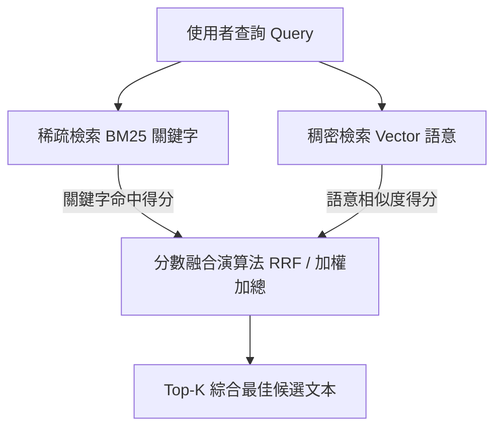
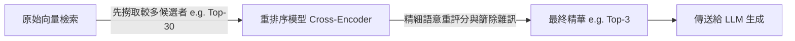

# 04. 進階檢索技術與架構延伸 (Advanced RAG)

## 一、基礎 RAG（Naive RAG）的瓶頸
在最樸素的「切塊 $\to$ 向量化 $\to$ 抓取 Top-K $\to$ 生成」流程中，常常出現以下三大痛點 [^3]：
1. **關鍵字精準度不足**：面對產品型號（如 `ESP32-S3`、`RTX 4090`）、特定編號、縮寫或冷僻術語時，純語意向量往往找不到完全一致的單詞 [^5]。
2. **檢索雜訊與前段排序失真**：向量距離最近的前幾筆，可能只是文字口氣相似，但關鍵答案藏在第 8 或第 10 筆，而 LLM 上下文無法容納過多篇幅。
3. **全局脈絡斷裂**：切塊切碎了文件結構，當使用者詢問「這份報告的整體核心主題是什麼？」或「主角 A 與實體 B 跨越三章的關聯為何？」時，片段檢索無法回答宏觀問題。

為此，現代工程衍生出「進階 RAG（Advanced RAG）」技術架構。

---

## 二、混合檢索（Hybrid Search）：語意 + 關鍵字強強聯手
**混合檢索（Hybrid Search）** 是將傳統資訊檢索的**稀疏檢索（Sparse Retrieval）** 與現代深度學習的**稠密向量檢索（Dense Retrieval）** 互相結合的技術 [^5]。

### 兩者互補特性
* **稠密檢索（Dense Retrieval / Vector）**：捕捉同義詞、概念抽象關聯（例如知道「小狗」跟「毛小孩」是同件事），擅長開放性語意理解。
* **稀疏檢索（Sparse Retrieval / BM25 / TF-IDF）**：精確鎖定字面完全吻合的單詞，對專有名詞、錯誤代碼、人名、電子元件規格特別敏銳。
* **互惠排名融合（Reciprocal Rank Fusion, RRF）**：根據兩種搜尋方式產生的名次倒數進行加權計分，無須在意兩者原始分數尺度差異，直接產出穩定平衡的排名清單。

---

## 三、重排序機制（Reranking）：精煉 Top-K 候選者
在真實系統中，檢索器為求速度，通常使用「雙塔架構（Bi-encoder）」——將 Query 與 Document 分開編碼，因此無法捕捉兩者深層的交互作用 [^1]。

**重排序模型（Reranker / Cross-Encoder）** 則將 Query 與候選 Document 放在一起同時輸入神經網路，逐字進行高精度的交叉注意力運算（Cross-Attention）[^3]：

* **比喻與效益**：向量檢索如同「海選初試（快速篩選 30~50 人）」，重排序則是「主管深度面試（挑選最具資格的 3 人）」。透過 Cross-Attention 機制，Reranker 能大幅修正前段向量檢索的排名失真，確保最具資訊量的文本送入 LLM 上下文 [^3]。
* **工程代價與額外開銷（Trade-offs & Overhead）**：
  * **額外推論延遲（Inference Latency）**：Bi-encoder 在離線建立向量後，在線僅需進行輕量向量內積計算；但 Cross-Encoder 必須在查詢當下，將「提問」與「每一個候選文本」拼接後重新執行完整的深度神經網路前向推論（Forward Pass）。當候選篇數較多（如 50 篇以上）時，端到端延遲可能增加幾十至數百毫秒（ms）。
  * **算力與輸送量瓶頸（Compute & Throughput Bottleneck）**：在面對高併發（High Concurrency）請求時，Reranker 常成為 GPU 算力瓶頸與成本熱點。
  * **工程實踐建議**：候選清單不宜過大（一般實務建議控制在 Top 20～30 篇），並可選用經過模型蒸餾（Distillation）的輕量級 Reranker 模型（如 BGE-Reranker-base），以在精準度與回應速度間取得平衡。

---

## 四、知識圖譜 RAG（GraphRAG）：掌握實體複雜關係
傳統切塊會將長篇文本的關係鏈拆散。**GraphRAG**（由微軟等機構進一步推廣）結合了**知識圖譜（Knowledge Graph, KG）**：
1. **實體抽取（Entity Extraction）**：利用 LLM 自動從文件中提取人名、技術、元件等「實體（Nodes）」以及實體間的「關係（Edges）」。
2. **圖社群摘要（Community Summary）**：將相關的實體聚類成圖社群，為每個社群生成宏觀總結。
3. **宏觀檢索優勢**：在面對跨章節推理（Multi-hop Reasoning）或宏觀總結性問題時，GraphRAG 能沿著關係邊線搜尋，大幅彌補向量切塊的盲區。

---

## 參考文獻
[^1]: Lewis, P., et al. (2020). *Retrieval-Augmented Generation for Knowledge-Intensive NLP Tasks*. NeurIPS 2020. [arXiv:2005.11401](https://arxiv.org/abs/2005.11401)
[^3]: LlamaIndex. (2024). *High-Level Concepts: Building a RAG Pipeline*. [LlamaIndex 官方文件](https://docs.llamaindex.ai/en/stable/getting_started/concepts/)
[^5]: Pinecone. (2024). *Chunking Strategies for LLM Applications*. [Pinecone Learning Center](https://www.pinecone.io/learn/chunking-strategies/)
