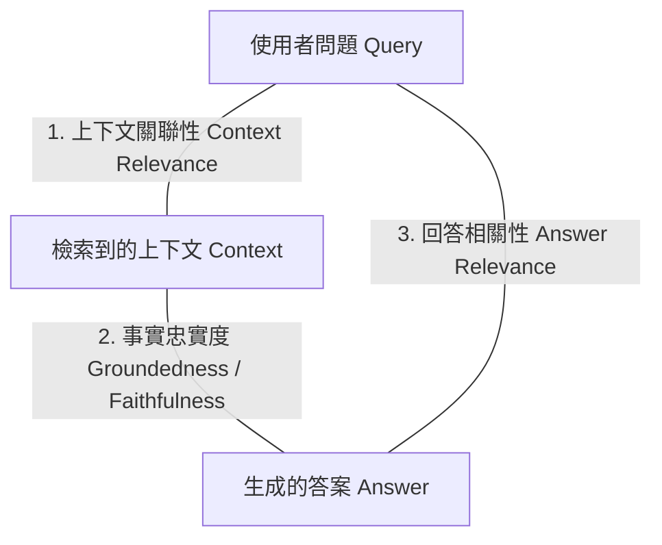

# 05. RAG 系統評估與品質指標 (Evaluation & Metrics)

## 一、為什麼 RAG 系統需要嚴謹評估？
在軟體工程中，傳統單元測試（Unit Test）可以透過明確的輸入/輸出（Assertion）驗證程式碼。然而在 RAG 系統中，輸出是由隨機性（Probabilistic）模型生成，且包含「檢索」與「生成」兩個串聯模組：
* 如果最終答案是錯的，究竟是**「檢索器沒撈到正確資料（Retrieval Failure）」**，還是**「資料撈到了但 LLM 自己腦補幻覺（Generation Failure）」**？
* 為此，我們必須將評估拆解為元件級別的獨立衡量指標 [^3][^4]。

---

## 二、黃金評估架構：RAG 三元組（RAG Triad）
業界目前最主流的評估框架（如 TruLens 與 Ragas）提出了**「RAG 三元組（RAG Triad）」**，將評估拆分為三大關鍵維度：



### 1. 上下文關聯性（Context Relevance）
* **評估對象**：使用者問題（Query） $\leftrightarrow$ 檢索到的上下文（Context）。
* **核心問題**：檢索器抓出來的這些文字區塊，真的跟使用者的問題相關嗎？有沒有抓了一堆不相干的雜訊？
* **衡量重點**：反映了檢索模組（Embedding + Vector DB + Reranker）的查準能力。

### 2. 事實忠實度 / 接地度（Groundedness / Faithfulness）
* **評估對象**：生成的答案（Answer） $\leftrightarrow$ 檢索到的上下文（Context）。
* **核心問題**：模型生成的每一句話，是否都能在提供的上下文（Context）中找到確鑿的事實證據？有沒有無中生有的腦補？
* **衡量重點**：反映了生成階段是否成功抑制模型幻覺（Hallucination）。若忠實度低，代表模型「脫稿演出」。

### 3. 回答相關性（Answer Relevance）
* **評估對象**：使用者問題（Query） $\leftrightarrow$ 生成的答案（Answer）。
* **核心問題**：模型產生的答案是否真正回答了使用者的問題？有沒有答非所問或文不對題？
* **衡量重點**：即便答案內容 100% 來自 Context，若只是重複複製無關句子而未解答核心疑惑，回答相關性依然會很低。

---

## 三、自動化評估方法：以大語言模型作為裁判（LLM-as-a-Judge）
在大型工程專案中，人工逐條標註（Human Annotation）成本極高。目前業界普及的做法是利用最強的頂級大模型（如 GPT-4）扮演「客觀裁判」，並透過結構化的評分規則（Rubrics）對上述指標進行 0 到 1 分或 1 到 5 分的自動化打分：

```text
【評分任務】：請評估 Answer 對於 Context 的事實忠實度（Groundedness）。
【評判準則】：
- 5 分：答案中的所有事實陳述皆能由 Context 明確推導出來。
- 3 分：答案大部分正確，但包含 1~2 項無法由 Context 證實的延伸推測。
- 1 分：答案包含大量虛構陳述或與 Context 明顯矛盾。
```

---

## 四、對初學者專題的實務建議
在課堂作業或小型專案展示時，初學者可以：
1. **建立小規模測試集（Golden Dataset）**：準備 10~15 組典型的 Question 與對應的 Ground Truth 答案。
2. **手動檢核 RAG Triad**：隨機抽樣檢驗檢索到的區塊是否含有答案關鍵字，並比對模型是否老實回答，作為品質驗證報告的核心佐證。

---

## 參考文獻
[^2]: LangChain. (2024). *Build a Retrieval Augmented Generation (RAG) App*. [LangChain 官方文件](https://python.langchain.com/docs/tutorials/rag/)
[^3]: LlamaIndex. (2024). *High-Level Concepts: Building a RAG Pipeline*. [LlamaIndex 官方文件](https://docs.llamaindex.ai/en/stable/getting_started/concepts/)
[^4]: Amazon Web Services (AWS). (2023). *What is RAG?*. [AWS 官方指南](https://aws.amazon.com/what-is/retrieval-augmented-generation/)
